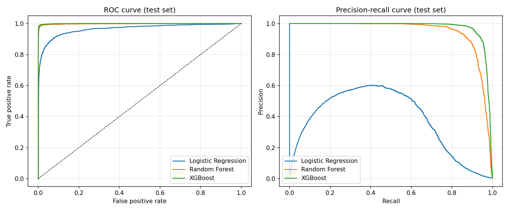
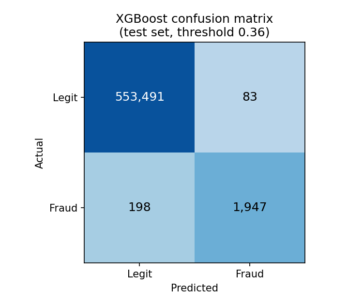
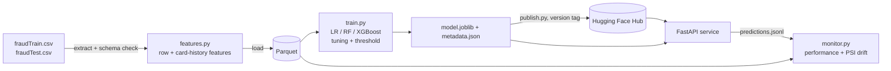

# Credit Card Fraud Detection: ML Pipeline

[](https://github.com/kkrit-tinna/Fraud_Detection_ML_Pipeline/actions/workflows/ci.yml)

This project detects fraudulent card transactions across **1.85M transactions** (0.5% fraud). It covers:

* an ETL step that engineers features
* three tuned classifiers (Logistic Regression, Random Forest and XGBoost)
* a versioned model artifact on the Hugging Face Hub
* a **FastAPI** service for real-time scoring
* monitoring of performance and data drift

## Results

All numbers are on the untouched test file `fraudTest.csv`: 555,719 transactions from Jun–Dec 2020, 0.39% fraud. The test set was not used for training, tuning or picking the decision threshold.

| Model | F1 | Precision | Recall | ROC-AUC | PR-AUC | Type II error rate | Missed frauds / all txns | Threshold |
|---|---|---|---|---|---|---|---|---|
| Logistic Regression | 0.555 | 0.525 | 0.588 | 0.9653 | 0.376 | 41.2% | 0.159% | 0.76 |
| Random Forest | 0.891 | 0.915 | 0.869 | 0.9978 | 0.944 | 13.1% | 0.051% | 0.46 |
| **XGBoost** (shipped) | **0.933** | 0.959 | 0.908 | 0.9994 | 0.973 | **9.2%** | 0.036% | 0.36 |

* **Type II error rate** = missed frauds ÷ all frauds (= 1 − recall).
* **Missed frauds / all txns** = missed frauds ÷ all transactions scored.
* Thresholds maximise F1 on a time-based validation split, the last 15% of `fraudTrain.csv`.

The shipped XGBoost model catches 1,947 of 2,145 test frauds and raises 83 false alarms among 553,574 legitimate transactions (Type I error rate 0.015%).

**Two operating points for the shipped model.** Both thresholds were chosen on validation only.

| Operating point | Rule (validation) | Threshold | F1 | Precision | Recall | Type II error rate | Type I error rate | False alarms |
|---|---|---|---|---|---|---|---|---|
| F1-optimal (default) | maximise F1 on validation | 0.359 | 0.933 | 0.959 | 0.908 | 9.2% | 0.015% | 83 |
| High-recall | highest threshold with validation recall >= 0.97 | 0.087 | 0.907 | 0.862 | 0.956 | 4.4% | 0.059% | 329 |

| | |
|---|---|
|  |  |

For the full write-up, including hyperparameter search, feature importance and the monitoring replay, see [`reports/results.ipynb`](reports/results.ipynb).

## Quickstart

```bash
git clone https://github.com/kkrit-tinna/Fraud_Detection_ML_Pipeline.git
cd Fraud_Detection_ML_Pipeline
python -m venv .venv && source .venv/bin/activate      # Python 3.10–3.13
pip install -r requirements.txt -r requirements-dev.txt
```

### Option A: serve the published model (no data needed)

```bash
export FRAUD_HF_REPO_ID=kkrit-tinna/credit-card-fraud-xgboost   # pulled from the Hugging Face Hub on startup
export FRAUD_HF_REVISION=v2.0.0         # pin a model version
make serve                              # http://localhost:8000/docs
```

### Option B: reproduce everything from the raw data

1. Download `fraudTrain.csv` and `fraudTest.csv` from Kaggle ([kartik2112/fraud-detection](https://www.kaggle.com/datasets/kartik2112/fraud-detection)) into `data/`. You can also point `FRAUD_DATA_DIR` at another folder.
2. Run the whole pipeline: ETL → train and compare → evaluate → monitor.

   ```bash
   make pipeline
   ```

   This takes about 10 minutes on a 2-core CPU. If you don't have `make`, run `python -m fraud_detection.pipeline` instead.
3. Serve your own model.

   ```bash
   make serve
   ```

### Score a transaction

The client sends the raw transaction plus the card's recent history. In production, a feature store would supply the history.

```bash
curl -X POST localhost:8000/predict -H "Content-Type: application/json" -d '{
  "trans_date_trans_time": "2020-06-21T23:14:25", "amt": 950.0, "category": "shopping_net",
  "merch_lat": 34.1, "merch_long": -81.0, "gender": "F", "dob": "1968-03-19",
  "lat": 33.97, "long": -80.94, "city_pop": 333497,
  "secs_since_last_txn": 420, "card_txn_count_1h": 3, "card_txn_count_24h": 6,
  "card_txn_count_7d": 20, "card_amt_sum_24h": 2900.0, "card_avg_amt": 55.0
}'
# {"is_fraud": true, "fraud_probability": 0.97, "risk_level": "HIGH", "threshold": ..., "model_version": "v2.0.0", ...}
```

| Endpoint | Purpose |
|---|---|
| `POST /predict` | Score one transaction |
| `POST /predict/batch` | Score up to 1,000 transactions |
| `GET /model/info` | Model name, version, threshold, git commit and metrics |
| `GET /health` | Liveness and whether the model loaded |

The API uses the F1-optimal threshold by default. Set `FRAUD_OPERATING_POINT=high_recall` to catch more fraud in exchange for more false alarms.

Median latency is about 13 ms per request, measured in-process on 2 vCPUs including feature computation.

## How it works



**ETL (`make etl`).** The extract step reads the raw CSVs and validates them against the expected schema: required columns, no nulls, known categories, 0/1 labels. The transform step engineers 18 numeric features and 1 categorical feature, and the load step writes them to Parquet with a manifest that includes SHA-256 hashes of the raw files.

* **Row features:** amount (raw and log), merchant category, cyclical hour and day-of-week, night/weekend flags, cardholder age and gender, log city population, and cardholder-to-merchant haversine distance.
* **Card-history features:** transaction counts in the previous 1h, 24h and 7d, spend in the previous 24h, time since the card's previous transaction, and the amount relative to the card's prior average. These use only *earlier* transactions on the same card, so there's no look-ahead leakage.

**Training (`make train`).** Each model is a single imbalanced-learn `Pipeline` (preprocessing → SMOTE → classifier). Because SMOTE sits inside the pipeline, it only resamples data a model is fitted on; validation and test data are never oversampled. Candidates are compared on validation PR-AUC. The winner is refitted on the training split, its threshold is tuned for F1 on validation, and every model is scored once on the test file. The model with the best validation F1 is shipped.

**Model versioning.** Every run writes `metadata.json` alongside the model: version, decision threshold, hyperparameters, feature list, validation and test metrics, raw-data hashes, git commit and library versions. `make publish` uploads the artifact and a generated model card to the Hugging Face Hub and tags the commit with the version (for example `v2.0.0`). The API can pin an exact version with `FRAUD_HF_REVISION`.

**Monitoring (`make monitor`).** There are two parts:

* *Replay:* scores the test period month by month, as if labels arrived monthly, and reports F1, precision, recall and Type II error at the shipped threshold, plus the Population Stability Index (PSI) of every feature against training. It raises an alert if recall drops more than 5 points below validation or any PSI exceeds 0.2. Output goes to `reports/monitoring/`.
* *Live:* the API logs every prediction (features, score, model version, latency) to `artifacts/logs/predictions.jsonl`. `make monitor` summarises volume, alert rate, latency and feature drift from that log.

## Project structure

```
fraud_detection/
  data.py        extract + schema validation, Parquet load
  features.py    row and card-history feature engineering (shared by training and the API)
  etl.py         ETL entry point
  model.py       LR / RF / XGBoost pipelines and search spaces
  evaluate.py    metrics and error-rate definitions
  train.py       tuning, threshold selection, comparison, artifact + reports
  registry.py    save/load artifacts locally or from the Hugging Face Hub
  publish.py     upload + version-tag the model on the Hub, with a model card
  monitor.py     monthly performance replay, PSI drift, prediction-log summary
  pipeline.py    one-command run (ETL → train → monitor)
  api/app.py     FastAPI service
tests/           unit and end-to-end tests on synthetic data (run in CI)
reports/         comparison table, figures, monitoring output, results notebook
notebook/        original 2025 exploratory notebooks (see note below)
```

## Tests and CI

`make test` runs unit tests for the feature logic and metric definitions. It also runs an end-to-end test on synthetic data that goes through ETL → fit → save → load → API (`/predict`, `/predict/batch`, validation errors, prediction logging) → drift. GitHub Actions runs the suite on Python 3.11 and 3.12 for every push.

## Notes and limitations

* The data is the public **simulated** Sparkov dataset, not real bank transactions.
* `notebook/` holds the original 2025 exploratory notebooks, kept for the EDA. Their modelling sections predate this pipeline: one oversampled the test set, and another reported false positives as Type II errors. Current results come only from `make pipeline` and `reports/`.
* The API expects the card-history values to be precomputed by the caller.

## License

MIT
